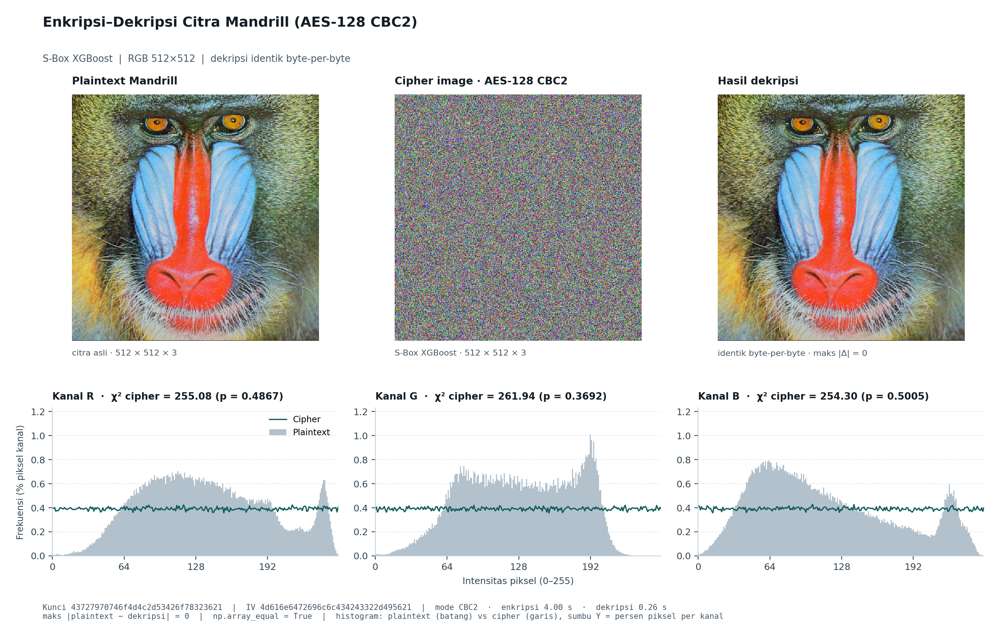
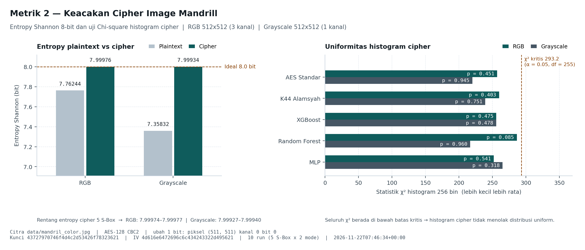
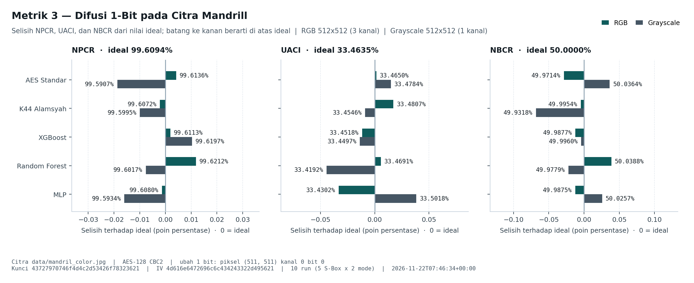

# Pengujian Keamanan Citra Mandrill (Metrik 2 & Metrik 3)

Dokumen ini memuat narasi, tabel, dan gambar untuk Bab 2.6 (persamaan formal), Bab 3.5.3
(protokol pengujian), Bab 4.3 (hasil dan pembahasan), serta poin kesimpulan Bab 5.1.
Seluruh angka berasal dari `results/mandrill_metrics.json` yang dihasilkan
`python -m src.mandrill_eval`, sehingga dapat direproduksi ulang.

| Slot laporan | Isi dokumen ini |
| :--- | :--- |
| §2.6 — Persamaan Metrik 2 & 3 | Bagian [1](#1-persamaan-formal-untuk-26) (entropy, Chi-square, NPCR, UACI, NBCR) |
| §3.5.3 — Skenario pengujian | Bagian [2](#2-protokol-pengujian-untuk-353) |
| §4.3 — Hasil & pembahasan | Bagian [3](#3-hasil-dan-pembahasan-untuk-43) (Tabel 4.3, Gambar 4.2, Gambar 4.3a/4.3b, analisis) |
| §5.1 — Kesimpulan | Bagian [4](#4-poin-kesimpulan-untuk-51) |

---

## 1. Persamaan formal (untuk §2.6)

### 1.1 Information Entropy (Metrik 2)

Untuk citra terenkripsi $C$ berukuran $M \times N$ dengan $K$ kanal, entropy Shannon
didefinisikan atas distribusi intensitas 8-bit:

$$
H(C) = -\sum_{k=0}^{255} p(k)\log_2 p(k), \qquad
p(k) = \frac{n_k}{M \cdot N \cdot K}
$$

dengan $n_k$ adalah jumlah elemen citra bernilai intensitas $k$. Nilai maksimum yang
mungkin dicapai adalah $H_{\text{ideal}} = \log_2 256 = 8{,}00000$ bit, yang hanya
terpenuhi bila seluruh 256 nilai intensitas muncul dengan frekuensi sama. Pada
implementasi `src/image_metrics.py`, seluruh kanal digabung dalam satu distribusi
($M \cdot N \cdot K$ elemen), sehingga citra RGB dan grayscale diukur dengan rumus yang
sama. Semakin dekat $H(C)$ ke 8,00000 bit, semakin kecil peluang penyerang memperoleh
informasi statistik dari cipher image.

### 1.2 Histogram dan uji Chi-square (Metrik 2)

Keseragaman histogram diuji dengan statistik Pearson:

$$
\chi^2 = \sum_{k=0}^{255} \frac{(o_k - e_k)^2}{e_k}, \qquad
e_k = \frac{M \cdot N \cdot K}{256}
$$

dengan $o_k$ frekuensi teramati dan $e_k$ frekuensi harapan pada distribusi uniform.
Statistik ini mengikuti distribusi $\chi^2$ dengan derajat kebebasan $df = 256 - 1 = 255$.
Kriteria lulus:

- $\chi^2_{\text{hitung}} < \chi^2_{0{,}05;\,255} = 293{,}2478$, atau ekuivalen
- $p\text{-value} = P\left(\chi^2_{255} \ge \chi^2_{\text{hitung}}\right) > 0{,}05$.

Nilai $p$ yang besar berarti histogram cipher tidak dapat dibedakan secara statistik dari
distribusi uniform; nilai $p$ yang sangat kecil menandakan pola frekuensi yang masih
terbawa dari plaintext.

### 1.3 NPCR (Metrik 3)

Untuk dua cipher image $C_1$ dan $C_2$ berukuran sama, didefinisikan matriks perbedaan

$$
D_c(i,j) =
\begin{cases}
0, & C_1(i,j,c) = C_2(i,j,c)\\
1, & C_1(i,j,c) \ne C_2(i,j,c)
\end{cases}
$$

NPCR dihitung per kanal lalu dirata-ratakan atas $K$ kanal:

$$
\mathrm{NPCR}_c = \frac{100}{M \cdot N}\sum_{i=1}^{M}\sum_{j=1}^{N} D_c(i,j),
\qquad
\mathrm{NPCR} = \frac{1}{K}\sum_{c=1}^{K} \mathrm{NPCR}_c
$$

Konvensi rata-rata per kanal dipakai agar citra RGB 24-bit dapat dibandingkan langsung
dengan nilai ideal 8-bit. Untuk citra 8-bit ($F = 255$), nilai harapan NPCR pada cipher
image yang ideal adalah

$$
\mu_{\mathrm{NPCR}} = 100 \cdot \frac{F}{F+1} = 99{,}6094\%.
$$

Berdasarkan Wu et al. (2011), uji NPCR bersifat satu sisi dengan ambang kritis pada
$\alpha = 0{,}05$:

| Ukuran citra | $N^{*}_{0{,}05}$ (NPCR minimum) |
| :--- | :---: |
| $256 \times 256$ | 99,5693% |
| $512 \times 512$ | **99,5893%** |
| $1024 \times 1024$ | 99,5994% |

Cipher image dinyatakan lulus bila $\mathrm{NPCR} \ge 99{,}5893\%$ (untuk citra uji
$512 \times 512$).

### 1.4 UACI (Metrik 3)

$$
\mathrm{UACI}_c = \frac{100}{F \cdot M \cdot N}\sum_{i=1}^{M}\sum_{j=1}^{N}
\left| C_1(i,j,c) - C_2(i,j,c) \right|,
\qquad
\mathrm{UACI} = \frac{1}{K}\sum_{c=1}^{K} \mathrm{UACI}_c
$$

dengan $F = 255$. Nilai harapan UACI untuk cipher image ideal adalah

$$
\mu_{\mathrm{UACI}} = 100 \cdot \frac{F+2}{3F+3} = 33{,}4635\%.
$$

Berbeda dengan NPCR, uji UACI bersifat dua sisi sehingga nilai yang terlalu kecil maupun
terlalu besar dianggap menyimpang. Interval penerimaan pada $\alpha = 0{,}05$ (Wu et al.,
2011) adalah:

| Ukuran citra | Interval UACI yang diterima |
| :--- | :---: |
| $256 \times 256$ | 33,2824% – 33,6447% |
| $512 \times 512$ | **33,3730% – 33,5541%** |
| $1024 \times 1024$ | 33,4183% – 33,5088% |

Cipher image dinyatakan lulus bila $\mathrm{UACI} \in [33{,}3730\%;\, 33{,}5541\%]$.

### 1.5 NBCR (metrik pendukung)

Untuk mengantisipasi kemungkinan bahwa istilah "MBCR" pada instruksi proyek merujuk pada
perubahan tingkat bit (bukan tingkat piksel), modul evaluasi juga menghitung Number of Bit
Change Rate:

$$
\mathrm{NBCR} = \frac{100}{8 \cdot M \cdot N \cdot K}
\sum_{\text{seluruh bit}} \left( C_1 \oplus C_2 \right)
$$

dengan nilai ideal 50%. Sebagaimana dicatat pada dokumen laporan, status NPCR vs NBCR masih
menunggu konfirmasi dosen; NPCR tetap menjadi metrik utama pada Tabel 4.3, sedangkan NBCR
dilaporkan sebagai pendukung agar laporan siap bila klarifikasi mengarah ke metrik
bit-level.

### 1.6 Mengapa $C_1$ dibandingkan dengan $C_2$, bukan plaintext dengan ciphertext

Entropy dan histogram mengukur sifat statistik satu citra, tetapi tidak mengukur seberapa
jauh satu perubahan kecil pada plaintext menyebar ke seluruh cipher image. Perbandingan
plaintext–ciphertext hanya menunjukkan bahwa enkripsi mengubah nilai piksel, sementara
penyerang diferensial justru memanfaatkan hubungan antara dua cipher image yang berasal
dari plaintext hampir identik. Karena itu NPCR dan UACI dihitung antara $C_1 = E(P)$ dan
$C_2 = E(P')$, dengan $P'$ berbeda 1 bit dari $P$ dan keduanya dienkripsi memakai kunci
serta IV identik — skenario chosen-plaintext paling dasar dalam kriptanalisis diferensial.

---

## 2. Protokol pengujian (untuk §3.5.3)

### 2.1 Konfigurasi

| Parameter | Nilai |
| :--- | :--- |
| Citra uji | `data/mandril_color.jpg`, $512 \times 512$ piksel |
| Mode citra | RGB 24-bit (3 kanal) dan grayscale 8-bit (1 kanal, hasil konversi `Image.convert("L")`) |
| S-Box yang diuji | AES Standar (FIPS-197), K44 Alamsyah, XGBoost (`results/sbox_xgb.npy`), Random Forest (`results/sbox_rf.npy`), MLP (`results/sbox_mlp.npy`) |
| Kunci AES-128 | `CryptoML-SBox26!` (`43727970746f4d4c2d53426f78323621`) |
| IV | `MandrillCBC2-IV!` (`4d616e6472696c6c434243322d495621`) |
| Mode operasi | CBC2 (CBC maju dilanjutkan CBC mundur), padding nol bila panjang bukan kelipatan 16 byte |
| Perubahan plaintext | 1 bit LSB dibalik pada piksel $(511, 511)$ kanal 0 (kanal R), yaitu piksel terakhir |
| Jumlah konfigurasi | 5 S-Box × 2 mode citra = 10 run |
| Metrik yang dicatat | Entropy plaintext/cipher, $\chi^2$ dan $p$-value, NPCR, UACI, NBCR, status dekripsi lossless, durasi enkripsi/dekripsi |
| Keluaran | `results/mandrill_metrics.json`, `results/figures/*.png` |

### 2.2 Langkah pengujian

1. Citra Mandrill dimuat sebagai array `uint8` (RGB 3 kanal atau grayscale 2 dimensi) memakai Pillow.
2. Plaintext $P$ dienkripsi dengan `encrypt_image_array(P, sbox, key, iv, mode="CBC2")` menghasilkan $C_1$.
3. Satu bit pada piksel $(511, 511)$ kanal 0 dibalik dengan operasi XOR (`ubah_satu_bit`), menghasilkan $P'$ yang berbeda tepat 1 bit.
4. $P'$ dienkripsi dengan kunci dan IV **identik**, menghasilkan $C_2$.
5. $C_1$ didekripsi ulang dan dibandingkan dengan $P$ memakai `np.array_equal` untuk memastikan dekripsi 100% lossless.
6. `evaluate_image_security(P, C1, C2)` menghitung entropy, $\chi^2$ + $p$-value, NPCR, UACI; NBCR dihitung terpisah sebagai metrik pendukung.
7. Langkah 2–6 diulang untuk kelima S-Box pada mode RGB dan grayscale, lalu hasilnya disimpan sebagai JSON dan divisualisasikan.

### 2.3 Alasan pemilihan piksel terakhir

Posisi piksel uji sengaja dipilih di piksel terakhir $(511, 511)$ karena merupakan kasus
terburuk untuk mode CBC satu lintasan: perubahan pada plaintext blok terakhir hanya
memengaruhi blok ciphertext terakhir, sehingga difusi tidak menyebar ke seluruh citra.
Dengan menguji posisi ini, klaim bahwa mode CBC2 memberikan difusi penuh dapat dibuktikan
secara langsung (lihat Bagian 3.8), bukan hanya diasumsikan.

### 2.4 Catatan implementasi

- Perhitungan Metrik 2 dan 3 dipusatkan di `src/image_metrics.py` (`evaluate_image_security`), yang otomatis dipakai juga oleh aplikasi web melalui `src/web_helpers.py`.
- Runner batch berada di `src/mandrill_eval.py`; setiap kombinasi S-Box dan mode citra dicatat beserta durasi enkripsi dan dekripsi.
- Pada perangkat uji tanpa akselerasi perangkat keras, enkripsi satu citra $512 \times 512$ memerlukan 4,04–12,06 detik dan dekripsi 0,10–0,57 detik.

---

## 3. Hasil dan pembahasan (untuk §4.3)

Pengujian dilakukan pada 22 November 2026 dengan konfigurasi pada Bagian 2. Ringkasan
kolektif: NPCR 99,5907–99,6212%, UACI 33,4192–33,5018%, entropy cipher 7,99927–7,99977 bit,
$\chi^2$ 216,82–286,49 ($p$ = 0,0853–0,9602), dan dekripsi lossless pada 10 dari 10
konfigurasi.

### 3.1 Tabel 4.3

**Tabel 4.3** Hasil Evaluasi Keamanan Citra Mandrill $512 \times 512$ pada AES-128 CBC2 (Metrik 2 & Metrik 3)

| S-Box | Mode | Entropy Plain | Entropy Cipher | Chi-Square (p-val) | NPCR (%) | UACI (%) | Lossless |
| :--- | :--- | :---: | :---: | :---: | :---: | :---: | :---: |
| AES Standar | RGB | 7,76244 | 7,99976 | 257,13 (p = 0,4508) | 99,6136 | 33,4650 | Ya |
| AES Standar | Grayscale | 7,35832 | 7,99939 | 220,04 (p = 0,9447) | 99,5907 | 33,4784 | Ya |
| K44 Alamsyah | RGB | 7,76244 | 7,99976 | 259,91 (p = 0,4031) | 99,6072 | 33,4807 | Ya |
| K44 Alamsyah | Grayscale | 7,35832 | 7,99934 | 239,35 (p = 0,7511) | 99,5995 | 33,4546 | Ya |
| S-Box XGBoost | RGB | 7,76244 | 7,99977 | 255,72 (p = 0,4755) | 99,6113 | 33,4518 | Ya |
| S-Box XGBoost | Grayscale | 7,35832 | 7,99930 | 255,60 (p = 0,4777) | 99,6197 | 33,4497 | Ya |
| S-Box Random Forest | RGB | 7,76244 | 7,99974 | 286,49 (p = 0,0853) | 99,6212 | 33,4691 | Ya |
| S-Box Random Forest | Grayscale | 7,35832 | 7,99940 | 216,82 (p = 0,9602) | 99,6017 | 33,4192 | Ya |
| S-Box MLP | RGB | 7,76244 | 7,99977 | 252,04 (p = 0,5406) | 99,6080 | 33,4302 | Ya |
| S-Box MLP | Grayscale | 7,35832 | 7,99927 | 265,15 (p = 0,3181) | 99,5934 | 33,5018 | Ya |

Catatan tabel:

1. Acuan ideal: entropy 8,00000 bit; NPCR minimum 99,5893%; UACI dalam selang 33,3730–33,5541%; $\chi^2_{0,05;255}$ = 293,2478.
2. Seluruh konfigurasi memenuhi keempat kriteria. Margin terdekat adalah NPCR AES Standar grayscale, yaitu 0,0014 poin persentase di atas ambang.
3. Nilai NBCR (pendukung, ideal 50%) berada pada 49,9318–50,0388%.
4. Angka pada baris XGBoost RGB di laporan sebelumnya (entropy cipher 7,99978; NPCR 99,6166%; UACI 33,4645%) berasal dari notebook Kaggle dengan kunci, IV, dan posisi piksel uji yang berbeda. Nilai pada tabel ini adalah hasil runner repo yang dapat direproduksi; entropy plaintext keduanya identik (7,76244).

### 3.2 Gambar 4.2 — visual enkripsi, dekripsi, dan histogram RGB

**Gambar 4.2** Visualisasi hasil enkripsi, dekripsi 100% lossless, dan perbandingan histogram RGB citra Mandrill menggunakan AES-128 CBC2 dengan S-Box XGBoost (`0x1E7`, `C=0x07`).



Panel atas memperlihatkan plaintext, cipher image, dan hasil dekripsi. Cipher image tidak lagi
memuat struktur objek yang dapat dikenali, sedangkan hasil dekripsi identik byte-per-byte dengan
plaintext (`np.array_equal` bernilai benar, selisih maksimum 0). Panel bawah membandingkan
histogram kanal R, G, dan B: plaintext (batang abu-abu) memusat pada rentang intensitas tertentu,
sedangkan cipher image (garis teal) mendatar di sekitar 0,39% per intensitas — setara distribusi
uniform $1/256$ — dengan $\chi^2$ kanal R, G, dan B berturut-turut 255,08 ($p$ = 0,4867),
261,94 ($p$ = 0,3692), dan 254,30 ($p$ = 0,5005). Nilai $\chi^2$ pada gambar dihitung per kanal
(df = 255 per kanal), berbeda dari $\chi^2$ gabungan tiga kanal yang dilaporkan pada Tabel 4.3
(255,72; $p$ = 0,4755). Gambar dihasilkan dari citra dan konfigurasi yang sama dengan Tabel 4.3
(mode CBC2, S-Box XGBoost, kunci dan IV identik).

### 3.3 Gambar 4.3 — grafik perbandingan metrik

**Gambar 4.3a** Entropy plaintext vs cipher dan uniformitas histogram cipher (uji Chi-square) kelima S-Box pada citra Mandrill.



**Gambar 4.3b** Selisih NPCR, UACI, dan NBCR terhadap nilai ideal (dalam poin persentase) untuk kelima S-Box pada mode RGB dan grayscale. Sumbu diperbesar karena rentang antar S-Box hanya 0,03–0,08 poin persentase.



### 3.4 Metrik 2 — keacakan cipher image

Entropy plaintext Mandrill adalah 7,76244 bit untuk RGB dan 7,35832 bit untuk grayscale,
jauh di bawah nilai maksimum karena citra alami memiliki distribusi intensitas yang tidak
merata (banyak area gelap dan tekstur berulang pada bulu serta wajah monyet). Setelah
enkripsi, entropy seluruh cipher image berada pada 7,99927–7,99977 bit, yaitu hanya
0,00023–0,00073 bit di bawah nilai maksimum teoretis 8,00000 bit. Kenaikan entropy mencapai
+0,23730 sampai +0,23733 bit pada RGB dan +0,64095 sampai +0,64108 bit pada grayscale.
Rentang sempit ini menunjukkan bahwa pengurangan redundansi spasial tidak lagi bergantung
pada S-Box yang dipakai, melainkan pada struktur dua lintasan CBC2 yang menerapkan
SubBytes, ShiftRows, dan MixColumns berulang pada setiap byte citra.

Hasil uji Chi-square memperkuat temuan tersebut. Statistik $\chi^2$ seluruh konfigurasi
berada pada 216,82–286,49, masih di bawah batas kritis 293,2478, dengan $p$-value
0,0853–0,9602 sehingga hipotesis distribusi uniform tidak ditolak pada $\alpha = 0{,}05$.
Nilai $p$ terkecil muncul pada S-Box Random Forest RGB (0,0853) dan nilai terbesar pada
S-Box Random Forest grayscale (0,9602); kedua angka tersebut berada pada sisi penerimaan
yang sama, sehingga perbedaan ini lebih mencerminkan variasi acak satu kali pengukuran
daripada keunggulan sistematis salah satu S-Box. Dengan histogram yang datar, penyerang
tidak memperoleh pola frekuensi yang dapat dipakai untuk analisis statistik orde pertama.

### 3.5 Metrik 3 — difusi perubahan 1 bit

NPCR seluruh konfigurasi berada pada 99,5907–99,6212%, berada di atas ambang kritis
99,5893% maupun di sekitar nilai ideal 99,6094%. Artinya, ketika satu bit pada piksel
terakhir plaintext dibalik, lebih dari 99,59% piksel cipher image berubah — praktis
seluruh citra. UACI berada pada 33,4192–33,5018%, seluruhnya di dalam selang penerimaan
33,3730–33,5541%, dengan jarak minimum 0,0462 poin persentase dari batas bawah dan 0,0523
poin persentase dari batas atas. Besaran ini menunjukkan bahwa selisih intensitas antar
dua cipher image setara dengan selisih dua citra acak yang saling independen, sehingga
hubungan statistik antara $C_1$ dan $C_2$ tidak dapat dieksploitasi.

NBCR sebagai metrik pendukung memberikan hasil yang konsisten: 49,9318–50,0388%, dengan
simpangan maksimum hanya 0,0682 poin persentase dari nilai ideal 50%. Baik NPCR maupun
NBCR mengarah pada kesimpulan yang sama, sehingga laporan tetap sahih bila klarifikasi
istilah "MBCR" dari dosen mengarah ke metrik tingkat bit.

### 3.6 Keutuhan dekripsi

Seluruh 10 konfigurasi menghasilkan dekripsi yang identik dengan plaintext asli
(`np.array_equal` bernilai benar). Karena cipher image berukuran tepat kelipatan 16 byte,
tidak ada byte padding yang perlu dibuang, dan proses dekripsi CBC2 mengembalikan citra
RGB maupun grayscale secara utuh. Hasil ini menunjukkan bahwa modifikasi S-Box tidak
merusak invertibilitas AES selama S-Box tetap bijektif, karena Inverse S-Box dibangun
otomatis dari S-Box kustom yang sama.

### 3.7 Perbandingan kelima S-Box pada citra Mandrill

Pada mode RGB, NPCR hanya berselisih 0,014 poin persentase antar S-Box
(99,6072–99,6212%) dan pada grayscale 0,029 poin persentase (99,5907–99,6197%). UACI
berselisih 0,0827 poin persentase (33,4192–33,5018%), lebih kecil daripada lebar selang
penerimaan Wu et al. (0,1811 poin persentase). Statistik $\chi^2$ memang memiliki rentang
yang lebih lebar (216,82–286,49), tetapi seluruhnya berada di bawah batas kritis dan
nilainya bergantung pada satu histogram tunggal, sehingga bukan ukuran difusi. Pola yang
muncul tidak konsisten: S-Box Random Forest unggul pada NPCR RGB (99,6212%) dan
$\chi^2$ grayscale (216,82) tetapi terendah pada UACI (33,4192%), sedangkan S-Box MLP
tertinggi pada UACI (33,5018%) tetapi terendah pada NPCR grayscale (99,5934%).

Ketidakadaan pemenang tunggal ini konsisten dengan hasil Metrik 1: ketiga S-Box hasil
Machine Learning memiliki Nonlinearity (112), BIC-NL (112), Differential Uniformity (4),
dan LAP (0,0625) yang identik, serta deviasi maksimum SAC yang sama (0,04688). Pada
tingkat citra, ukuran difusi agregat lebih ditentukan oleh MixColumns dan struktur dua
lintasan CBC2 yang menyebarkan perubahan ke seluruh blok, sedangkan S-Box berperan pada
lapisan nonlinier lokal. Karena pengukuran ini memakai satu kunci, satu IV, dan satu
posisi piksel, selisih di atas tidak dapat diklaim sebagai perbedaan yang signifikan
secara statistik; hal ini dicatat sebagai keterbatasan pada Bagian 3.9.

### 3.8 Pengaruh mode operasi: ECB vs CBC vs CBC2

Untuk menunjukkan pentingnya pemilihan mode, pengukuran yang sama diulang pada mode ECB
dan CBC dengan citra RGB dan konfigurasi kunci/IV serta posisi piksel yang identik
(`python -m src.mandrill_eval --modes RGB --cipher-mode ECB`, dan `--cipher-mode CBC`).

| S-Box | NPCR ECB (%) | NPCR CBC (%) | NPCR CBC2 (%) | UACI ECB (%) | UACI CBC (%) | UACI CBC2 (%) |
| :--- | :---: | :---: | :---: | :---: | :---: | :---: |
| AES Standar | 0,0020 | 0,0020 | 99,6136 | 0,0006 | 0,0008 | 33,4650 |
| K44 Alamsyah | 0,0020 | 0,0020 | 99,6072 | 0,0007 | 0,0010 | 33,4807 |
| S-Box XGBoost | 0,0020 | 0,0020 | 99,6113 | 0,0007 | 0,0007 | 33,4518 |
| S-Box Random Forest | 0,0020 | 0,0020 | 99,6212 | 0,0007 | 0,0006 | 33,4691 |
| S-Box MLP | 0,0020 | 0,0020 | 99,6080 | 0,0005 | 0,0006 | 33,4302 |

Angka 0,0020% tersebut dapat dijelaskan secara struktural: perubahan 1 bit berada di blok
terakhir, sehingga pada ECB hanya 1 blok ciphertext (16 byte) yang berubah dan pada CBC
satu lintasan perubahan hanya menyebar ke blok terakhir karena tidak ada blok berikutnya
yang dapat terpengaruh. Ukuran perubahan tersebut adalah $16/786.432 \approx 0{,}00203\%$
dari total byte citra, persis seperti yang terukur. Mode CBC2 menjalankan CBC mundur
setelah CBC maju, sehingga blok terakhir pada lintasan pertama menjadi blok pertama pada
lintasan kedua dan perubahannya terdifusi ke seluruh citra.

Temuan penting kedua adalah bahwa Metrik 2 tetap "lulus" pada ECB dan CBC: entropy cipher
7,99974–7,99979 bit dan $\chi^2$ 223,15–284,48 ($p$ = 0,0990–0,9256). Dengan demikian uji
keacakan orde pertama tidak mampu mendeteksi kegagalan difusi; hanya Metrik 3 (NPCR/UACI)
yang mengungkapkannya. Inilah alasan mode CBC2 dijadikan mode default pada
`src/aes_cipher_runner.py`, dan sekaligus alasan Metrik 2 tidak boleh digunakan sendirian
sebagai bukti ketahanan enkripsi citra.

### 3.9 Keterbatasan pengujian

1. Setiap konfigurasi diukur satu kali pada satu kunci, satu IV, dan satu posisi piksel (piksel terakhir). Uji diferensial yang lengkap memerlukan banyak kunci dan posisi piksel untuk memperoleh sebaran NPCR/UACI beserta selang kepercayaan.
2. NPCR dan UACI dihitung sebagai rata-rata per kanal untuk citra RGB, sedangkan ambang Wu et al. (2011) diturunkan untuk citra 8-bit satu kanal. Konvensi rata-rata per kanal digunakan agar dapat dibandingkan dengan ambang tersebut, dan perlu dinyatakan eksplisit di laporan.
3. Citra uji hanya Mandrill dalam format JPEG. Pengujian pada citra PNG, citra medis, atau resolusi lain (mis. $1024 \times 1024$) belum dilakukan, padahal ambang kritis bergantung pada ukuran citra.
4. Status metrik utama (NPCR atau NBCR) masih menunggu klarifikasi dosen; laporan ini menampilkan NPCR sebagai metrik utama dan NBCR sebagai pendukung.

---

## 4. Poin kesimpulan (untuk §5.1)

Kelima S-Box — AES Standar, K44 Alamsyah, XGBoost, Random Forest, dan MLP — menghasilkan
kinerja keamanan citra yang setara pada citra Mandrill $512 \times 512$ dengan AES-128 mode
CBC2: entropy cipher 7,99927–7,99977 bit (ideal 8,00000), histogram cipher seragam dengan
$\chi^2$ 216,82–286,49 di bawah batas kritis 293,2478 ($p$ = 0,0853–0,9602), NPCR
99,5907–99,6212% (lulus ambang 99,5893%), UACI 33,4192–33,5018% (dalam selang
33,3730–33,5541%), NBCR 49,9318–50,0388% (ideal 50%), serta dekripsi lossless pada seluruh
10 konfigurasi. Perbedaan antar S-Box hanya 0,014–0,083 poin persentase sehingga tidak ada
S-Box yang unggul sistematis; pemilihan S-Box tetap ditentukan oleh Metrik 1, sedangkan
ketahanan difusi pada citra ditentukan oleh mode CBC2 — terbukti dari NPCR yang hanya
0,0020% pada ECB dan CBC satu lintasan untuk kasus piksel terakhir, dibandingkan 99,6% pada
CBC2.

---

## 5. Reproduksi

```bash
# Evaluasi Metrik 2 & 3 untuk 5 S-Box × RGB/Grayscale (menulis results/mandrill_metrics.json)
python -m src.mandrill_eval

# Grafik untuk laporan (menulis results/figures/*.png)
python -m src.visualize_mandrill

# Gambar 4.2: enkripsi, dekripsi, dan histogram RGB (S-Box XGBoost)
python -m src.visualize_mandrill --showcase

# Data pembanding mode operasi pada Bagian 3.8 (citra RGB)
python -m src.mandrill_eval --modes RGB --cipher-mode ECB --out results/mandrill_ecb.json
python -m src.mandrill_eval --modes RGB --cipher-mode CBC --out results/mandrill_cbc.json
```

Berkas JSON pada dua perintah terakhir belum disertakan di repositori; angka pada Bagian
3.8 dihasilkan langsung dari perintah tersebut. Bila ingin diarsipkan sebagai bukti
pengukuran, jalankan perintahnya dengan `--out` seperti di atas.

Gambar 4.2 memakai kunci, IV, dan mode yang sama dengan Tabel 4.3, sehingga histogram pada
gambar tersebut konsisten dengan nilai entropy dan $\chi^2$ yang dilaporkan.
